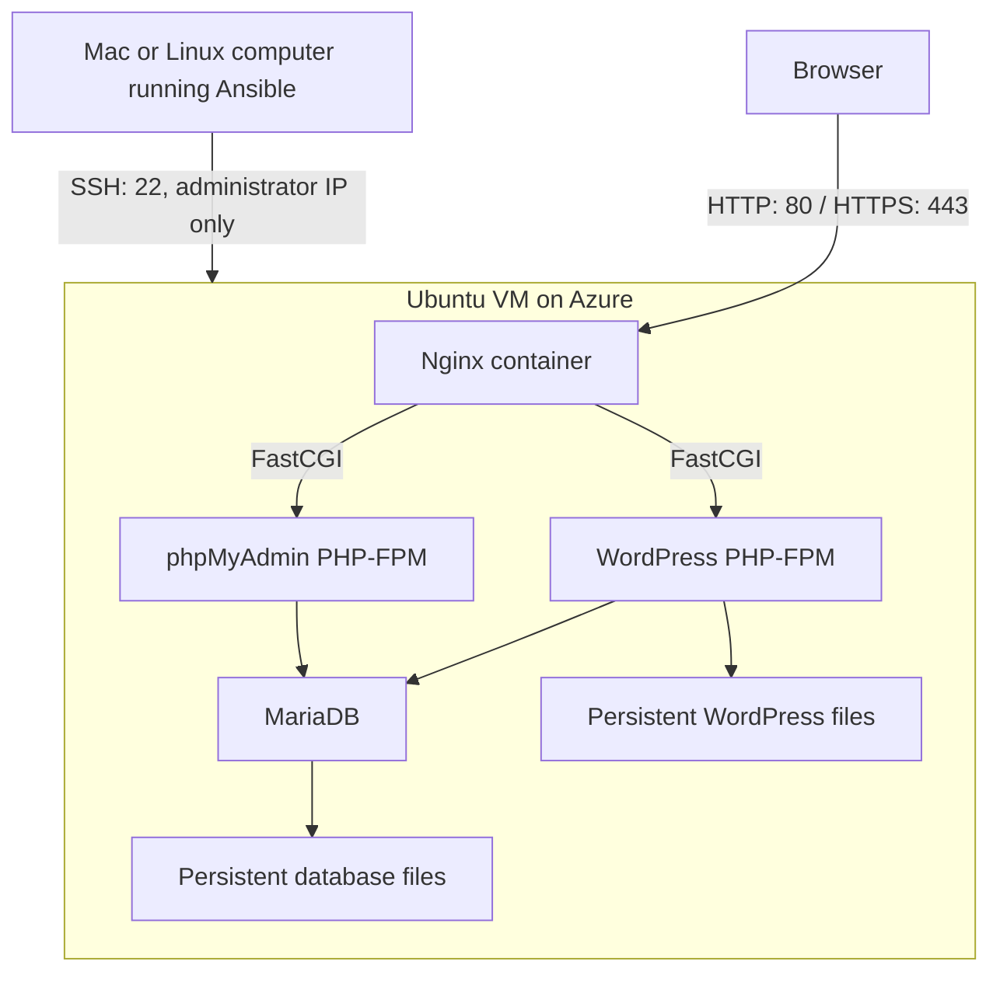

# Cloud-1

Cloud-1 is a 42 system administration project about deploying a WordPress site to a remote server through automation. The point is to be able to start from a fresh Ubuntu machine, run the deployment, and get the same working setup without installing each service by hand.

This implementation uses Azure for the server, Bicep for the infrastructure, Ansible for configuration, and Docker Compose for the application. WordPress, MariaDB, phpMyAdmin and Nginx run in separate containers. Nginx handles HTTPS and routes requests to the right PHP service.

The first Azure deployment is running in France Central on Ubuntu 22.04.5 LTS. The deployment playbook completed with no failures, and the site opens over HTTPS without a browser certificate warning. That does not mean every evaluation test is finished: reboot persistence, parallel deployment and backup restoration still need to be demonstrated on Azure.

- [WordPress](https://cloud1-student-6be78209.francecentral.cloudapp.azure.com/)
- [WordPress administration](https://cloud1-student-6be78209.francecentral.cloudapp.azure.com/wp-admin/)
- [phpMyAdmin](https://cloud1-student-6be78209.francecentral.cloudapp.azure.com/phpmyadmin/)

The server may be deallocated between work sessions to conserve student credit, so these links are not a promise of continuous availability.

## What the project does

The deployment installs Docker on a fresh Ubuntu host, configures the host firewall, prepares persistent storage and starts the application. It then installs WordPress, creates its administrator and editor accounts, and requests a Let's Encrypt certificate.

Running the playbook again should preserve the database, uploads and accounts. Initialization checks the existing WordPress installation instead of reinstalling it. Database passwords cannot be changed just by editing a variable on an initialized server: the playbook stops rather than silently breaking the connection.

The inventory supports several independent servers. Each host has its own address and domain. This is not a shared-database cluster or a load-balanced WordPress installation.

## Architecture



| Component | Responsibility | Public access |
|---|---|---|
| Nginx | TLS, HTTP redirect, routing and static files | Ports 80 and 443 |
| WordPress PHP-FPM | WordPress application | Through Nginx |
| MariaDB | WordPress database | None; internal Docker network |
| phpMyAdmin PHP-FPM | Database management interface | `/phpmyadmin/` through Nginx |
| WP-CLI | Installation and account setup | One-shot container, no public port |
| SSH | Server administration | Port 22, restricted to the administrator's IPv4 address |

The backend Docker network is internal. WordPress and phpMyAdmin also join the frontend network so Nginx can reach them. MariaDB does not publish port 3306 on the host.

Azure's network security group and UFW both restrict incoming traffic. Docker can route published ports around UFW rules, so the Compose configuration only publishes Nginx's web ports. External connectivity still needs to be tested rather than inferred from a firewall screenshot.

## Why these tools

- **Azure for Students** provides credit for the VM, disk and networking. The selected size is `Standard_B2als_v2`, with 2 vCPUs and 4 GiB RAM.
- **Bicep** keeps the VM, network and firewall configuration in the repository. A deployment preview can be reviewed before creating resources.
- **Ansible** handles host configuration and application deployment through SSH. The roles separate system setup, certificates, the container stack and WordPress initialization.
- **Docker Compose** describes the services, networks, mounts and health checks in one file. The required `docker-compose.yml` is rendered on the server from a template.
- **Official images** are permitted by the Cloud-1 subject. They reduce the amount of image-maintenance work compared with the custom images used for Inception.

Image tags currently follow selected version families. They are not immutable digest pins. Record the tested image digests before evaluation if exact reproducibility is required.

## Repository layout

```text
.
├── README.md
├── docs/
│   ├── screenshots.md
│   └── screenshots/
├── en.subject.pdf
├── inception/                     # Original reference project
└── cloud-1/
    ├── azure/
    │   ├── main.bicep             # Azure infrastructure
    │   ├── parameters.example.json
    │   ├── deploy.sh              # Preflight, preview and explicit deployment
    │   ├── run_check.py           # Progress and timeout for Azure checks
    │   └── write_inventory.py     # Update one inventory host
    ├── ansible/
    │   ├── inventories/
    │   ├── roles/
    │   │   ├── common/
    │   │   ├── certificates/
    │   │   ├── docker_stack/
    │   │   └── wordpress_init/
    │   ├── site.yml
    │   ├── validate.yml
    │   ├── backup.yml
    │   ├── stop.yml
    │   └── destroy.yml
    ├── examples/                 # Dummy values, never production secrets
    ├── scripts/                  # Local checks and credential helpers
    ├── requirements-dev.txt
    └── READINESS_REPORT.md
```

`inception/` is reference material. Its original Makefile, ports and custom images are not used for the Cloud-1 deployment. In particular, do not run its destructive rebuild target against Cloud-1 data.

## Requirements

On the controlling computer:

- Git, Python and `uv` for the project environment.
- Azure CLI, signed in to the intended subscription.
- An SSH key pair. Only the public key is sent to Azure.
- Ansible and the collections listed in the repository.
- Docker only if running the disposable local integration test.

On a fresh target server:

- Ubuntu 22.04 LTS or a compatible Ubuntu host.
- SSH and Python available.
- An SSH user with passwordless sudo.
- A domain or DNS name pointing to the server for trusted HTTPS.

Azure quota and availability are separate checks. Having credit or a visible size in the portal does not guarantee allocation. This deployment uses a regional VM without specifying an availability zone.

## Set up the local environment

All commands below start at the repository root unless stated otherwise.

```sh
git clone https://github.com/riel-fas/cloud_1.git
cd cloud_1
uv venv .venv
uv pip install --python .venv/bin/python -r cloud-1/requirements-dev.txt
source .venv/bin/activate

export LANG=en_US.UTF-8
export LC_ALL=en_US.UTF-8
export ANSIBLE_CONFIG="$PWD/cloud-1/ansible/ansible.cfg"
export ANSIBLE_HOME="$PWD/.ansible"
export ANSIBLE_COLLECTIONS_PATH="$PWD/.collections"

ansible-galaxy collection install \
  -r cloud-1/ansible/requirements.yml -p .collections
```

Repeat the activation and exports in a new terminal. Dependencies and collections are local to the checkout and excluded from Git.

Sign in to Azure and verify the selected subscription:

```sh
az login
az account show --query '{Name:name,State:state}' --output table
```

For a dedicated SSH key, use a new filename so an existing key is not overwritten:

```sh
ssh-keygen -t rsa -b 4096 -f ~/.ssh/cloud1_azure -C cloud1-azure
ssh-add ~/.ssh/cloud1_azure
```

Keep the private key on the controlling computer. The `.pub` file is the value used in the Azure parameters.

## Configure Azure

Copy the example and edit the local file:

```sh
cp cloud-1/azure/parameters.example.json cloud-1/azure/parameters.json
```

| Parameter | Meaning | First deployment |
|---|---|---|
| `location` | Azure region | `francecentral` |
| `vmSize` | Available VM size with sufficient quota | `Standard_B2als_v2` |
| `adminUsername` | Linux SSH user | `azureuser` |
| `adminSshPublicKey` | Contents of the public key file | Your own public key |
| `adminAllowedCidr` | Administrator's public IPv4 followed by `/32` | Your current connection |
| `dnsLabelPrefix` | Available Azure public-IP DNS label | Choose your own label |
| `osDiskType` | Managed disk storage type | `StandardSSD_LRS` |
| `osDiskSizeGB` | OS disk size | `30` |

The example is a schema, not deployable credentials. The real parameters file is ignored by Git. If your public IP changes, the SSH allowlist must be updated deliberately in Azure and UFW.

Run the read-only checks:

```sh
bash cloud-1/azure/deploy.sh --preflight \
  'Azure for Students' rg-cloud1-francecentral \
  cloud-1/azure/parameters.json web_primary
```

The SKU lookup can take several minutes. Progress is printed every 15 seconds. A zone restriction does not automatically mean the whole region is unavailable; review its type and scope. If the resource group does not exist, preflight exits without creating it.

To create the infrastructure:

```sh
bash cloud-1/azure/deploy.sh --apply \
  'Azure for Students' rg-cloud1-francecentral \
  cloud-1/azure/parameters.json web_primary
```

The script asks for uppercase `CREATE` before creating a missing resource group. It then runs a what-if preview. Review the VM size, OS disk, SSH source and ports before typing uppercase `DEPLOY`. That second confirmation creates billable resources.

After deployment, the script writes the public IP and domain into the local inventory. It updates only the chosen host and preserves other entries.

## Configure Ansible and secrets

The real inventory is ignored by Git. If deploying to an existing server, create `cloud-1/ansible/inventories/hosts.yml` from `hosts.example.yml` and replace the example addresses. For an Azure-created host, edit the generated entry and add:

```yaml
ansible_ssh_private_key_file: ~/.ssh/cloud1_azure
ansible_python_interpreter: /usr/bin/python3
tls_mode: certbot
letsencrypt_email: your-email@example.com
```

Keep the generated `ansible_host`, `domain_name`, `ansible_user` and `admin_allowed_cidr` values. If the generated inventory is formatted as JSON, retain JSON syntax when editing it; JSON is valid YAML and Ansible accepts it.

Review `cloud-1/ansible/inventories/group_vars/all/vars.yml` for service images, site title, database name and WordPress usernames. Per-host values belong in the inventory when they differ between servers.

Create the encrypted vault:

```sh
EDITOR=nano ansible-vault create \
  cloud-1/ansible/inventories/group_vars/all/vault.yml
```

Use the four variable names in `cloud-1/examples/vault.example.yml`. Each password must be a string of at least 20 characters, without a placeholder or line break. The password used to unlock the vault is separate from these application passwords.

Before the first successful application deployment, the helper can generate four independent 48-character passwords inside the Vault editing process:

```sh
EDITOR="$PWD/.venv/bin/python $PWD/cloud-1/scripts/generate_vault_passwords.py" \
  ansible-vault edit cloud-1/ansible/inventories/group_vars/all/vault.yml
```

This replaces all four application passwords without printing them. It does not change the vault-unlock password. Do not use it to rotate credentials after the database has been initialized.

Check the encrypted file header without displaying its contents:

```sh
head -n 1 cloud-1/ansible/inventories/group_vars/all/vault.yml
```

It should begin with `$ANSIBLE_VAULT;`. Actual inventories, vaults, private keys, local Azure parameters and backups are excluded from Git.

## Deploy the application

First establish SSH access and verify the host fingerprint through a trusted Azure channel. Host-key verification remains enabled.

```sh
ssh -i ~/.ssh/cloud1_azure azureuser@YOUR_VM_IP
```

Return to the controlling computer and test Ansible:

```sh
ansible web_primary -m ansible.builtin.ping --ask-vault-pass
ansible web_primary -b -m ansible.builtin.command -a whoami --ask-vault-pass
```

The expected results are `pong` and `root`. The command module may report `CHANGED` for `whoami`; this is command reporting, not an actual server change.

Start deployment:

```sh
ansible-playbook cloud-1/ansible/site.yml \
  --limit web_primary --ask-vault-pass
```

The roles perform the following work:

1. Install prerequisites and Docker, enable Docker at boot, and configure UFW.
2. Create a temporary self-signed certificate so Nginx can start.
3. Render Compose and Nginx configuration, mount scoped secrets, and wait for service health checks.
4. Check database access, install WordPress if necessary, and create the editor if missing.
5. Obtain the Let's Encrypt certificate through HTTP-01, copy it into Nginx's certificate directory, reload Nginx and enable the renewal timer.

Certificate issuance failures stop the playbook. A temporary certificate is not treated as a successful trusted-HTTPS deployment. The renewal hook copies renewed files into the container mount, checks Nginx configuration and reloads it.

## Access the applications

| Application | URL | Credentials |
|---|---|---|
| WordPress | `https://YOUR_DOMAIN/` | Public homepage |
| WordPress dashboard | `https://YOUR_DOMAIN/wp-admin/` | `wp_admin_user` and `vault_wp_admin_password` |
| phpMyAdmin | `https://YOUR_DOMAIN/phpmyadmin/` | `db_user` and `vault_db_password` |

Defaults are `cloud_admin` for the WordPress administrator and `wp_user` for the application database user. The editor defaults to `evaluator`. Check the configured variables rather than assuming these names on a modified deployment.

Use `ansible-vault view` locally when you need to retrieve a generated password. Do not paste that output into an issue, screenshot or chat. phpMyAdmin should use the application database account; it does not need the database root password for normal inspection.

## Local checks

These checks can run before accessing Azure:

```sh
python cloud-1/scripts/local_validate.py
python cloud-1/scripts/test_regressions.py
bash cloud-1/scripts/test_tls_local.sh
ansible-playbook -i cloud-1/ansible/inventories/hosts.example.yml \
  cloud-1/ansible/site.yml --syntax-check \
  -e vault_file="$PWD/cloud-1/examples/vault.example.yml"
ansible-lint --offline --profile basic cloud-1/ansible
```

With Docker running locally, `python cloud-1/scripts/integration_local.py` starts a disposable stack on loopback ports 18080 and 18443. It tests the real WordPress initialization role twice, backup creation, routing and data persistence across container recreation. Its test containers, networks and volumes are removed afterward; downloaded image cache remains. Run only one copy at a time. This test does not connect to Azure or substitute for a host reboot test.

## Validate the deployment

```sh
ansible-playbook cloud-1/ansible/validate.yml \
  --limit web_primary --ask-vault-pass
```

This checks container state and health, database port bindings, HTTP redirect, HTTPS responses and WordPress installation. It does not replace an external port test, a reboot test, an actual database login or a restore test.

| Check | Current evidence |
|---|---|
| YAML, templates, Compose, shell syntax and Bicep compilation | Passed locally |
| Local container startup and HTTP/HTTPS routing | Passed |
| WordPress initialization role rerun | Passed locally with zero changes |
| Local backup creation and data surviving container recreation | Passed |
| Fresh Ubuntu host deployment on Azure | Completed; `failed=0`, `unreachable=0` |
| Let's Encrypt issuance and Nginx reload | Completed in the Azure deployment |
| Browser certificate warning | None reported when opening the site |
| Full Azure acceptance playbook | Result not yet recorded |
| Full deployment rerun after trusted TLS setup | Result not yet recorded |
| Reboot persistence on Azure | Pending |
| Second server deployed in parallel | Pending |
| Backup restoration and renewal dry run | Pending |

To test persistence, create a post, upload an image and create a test user. Record the results, reboot the VM during a maintenance window, and verify the same content and accounts afterward. Do not replace this test with a screenshot of storage directories.

For parallel deployment, use a separate resource group and DNS label for a second VM and give it a separate inventory alias. Remove `--limit web_primary` when intentionally deploying to both hosts. Keep each server's inventory variables separate.

See [the readiness report](cloud-1/READINESS_REPORT.md) for the evidence boundaries and remaining tests.

## Backups and routine operation

Create a database dump and WordPress archive:

```sh
ansible-playbook cloud-1/ansible/backup.yml \
  --limit web_primary --ask-vault-pass
```

Backups are written to `/opt/cloud-1/backups/` with restricted permissions. They are on the same VM, so copy them off-host before relying on them. Database and file backups are separate operations; stop writes when a coordinated snapshot is needed. A backup is not proven recoverable until it has been restored in a separate environment.

Stop the containers without deleting data:

```sh
ansible-playbook cloud-1/ansible/stop.yml \
  --limit web_primary --ask-vault-pass
```

Run `site.yml` again to bring the application back. Stopping containers does not stop VM billing.

On the server, these commands help with inspection:

```sh
cd /opt/cloud-1
sudo docker compose ps
sudo docker compose logs --tail=100 nginx
sudo docker compose logs --tail=100 wordpress
sudo systemctl status docker
sudo systemctl status certbot.timer
```

Avoid publishing complete logs without reviewing them for sensitive data.

## Costs and cleanup

The portal displayed an estimate of $31.03 per month for this VM's compute when it was selected. That was not a complete monthly bill: disk and public-IP charges are additional, and prices vary by region, subscription and time. Student credit is finite.

Deallocate the VM when it is not needed:

```sh
az vm deallocate --subscription 'Azure for Students' \
  --resource-group rg-cloud1-francecentral --name cloud1-vm
```

Start it again with:

```sh
az vm start --subscription 'Azure for Students' \
  --resource-group rg-cloud1-francecentral --name cloud1-vm
```

Deallocation stops compute billing, but the disk and public IP can still cost money. Budget alerts notify; they do not automatically shut down the server.

`destroy.yml` is deliberately separate from normal deployment. It requires `destroy_confirmation=I_CONFIRM_DATA_DESTRUCTION` and removes the application containers, named volumes and WordPress/database data. It preserves configuration and backup directories. It does not remove the Azure VM or stop Azure billing.

Deleting the Azure resource group removes its resources, including the VM and disk. Do that only after saving anything that must survive. No destructive command is part of normal validation.

## Screenshots

The subject does not require screenshots, but they make the results easier to review. Save real captures under `docs/screenshots/` and follow [the screenshot checklist](docs/screenshots.md).

The most useful captures are the WordPress page over HTTPS, certificate details, successful deployment recap, container status, phpMyAdmin tables and restricted Azure inbound rules. Add reboot and parallel-deployment screenshots only after those tests have actually been completed. There are no fabricated screenshots or broken image placeholders in this README.

## Known limits

- The first deployment uses one VM. It is not highly available.
- UFW, NSG and Docker port configuration still need an external connectivity check.
- Password rotation and domain migration are deliberate maintenance tasks, not automatic side effects of rerunning deployment.
- Image-family tags can change. phpMyAdmin upgrades may require refreshing its static-files volume while preserving database data.
- Ansible currently emits deprecation warnings for `apt_repository` and injected fact variables. They did not prevent deployment, but should be addressed before upgrading past their supported versions.
- The subject's final wording about connecting as root needs confirmation with the campus. This setup uses an SSH key and sudo; that is not presented as a definitive interpretation of the evaluation rule.

## References and AI assistance

- [Project subject](en.subject.pdf)
- [Azure Linux VMs](https://learn.microsoft.com/azure/virtual-machines/linux/)
- [Bicep](https://learn.microsoft.com/azure/azure-resource-manager/bicep/)
- [Ansible documentation](https://docs.ansible.com/)
- [Docker Compose](https://docs.docker.com/compose/)
- [WordPress official image](https://hub.docker.com/_/wordpress)
- [phpMyAdmin official image](https://hub.docker.com/_/phpmyadmin)
- [Certbot](https://eff-certbot.readthedocs.io/)

AI tools helped with the initial implementation, code review, troubleshooting and documentation. The first draft required corrections, including certificate bootstrapping, secret validation, health checks and inventory updates. The checked-in code and the recorded test results are the basis for evaluation; understanding and explaining them remains the student's responsibility.
