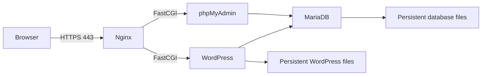
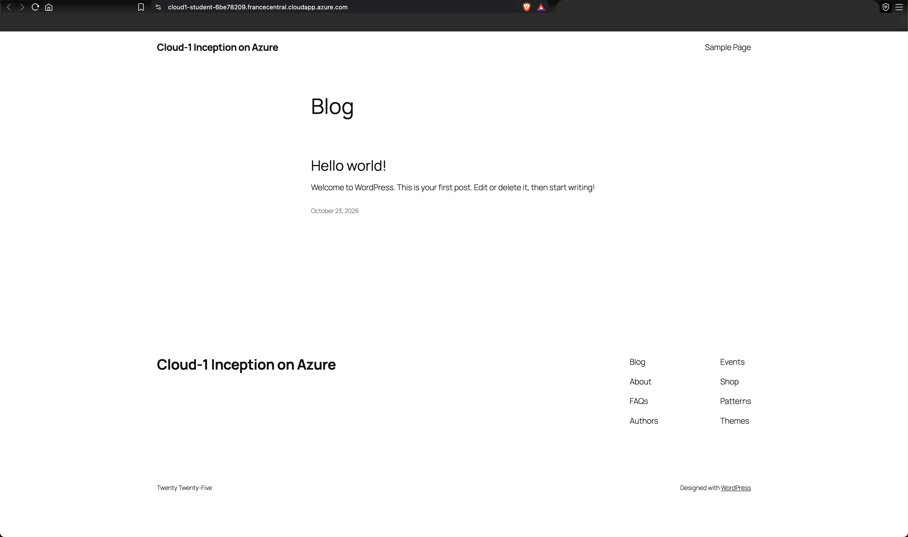
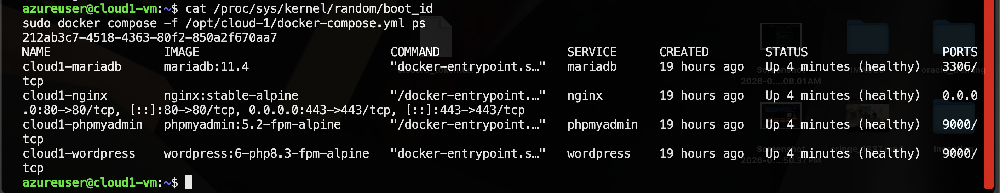

# Cloud-1

Automated deployment of WordPress on Azure for the 42 Cloud-1 project. Bicep creates the infrastructure, Ansible configures the Ubuntu server, and Docker Compose runs Nginx, WordPress, MariaDB and phpMyAdmin.

The deployment uses Azure for Students in France Central, with a `Standard_B2als_v2` VM (2 vCPUs, 4 GiB RAM) running Ubuntu 22.04.5 LTS.

- [WordPress](https://cloud1-student-6be78209.francecentral.cloudapp.azure.com/)
- [WordPress dashboard](https://cloud1-student-6be78209.francecentral.cloudapp.azure.com/wp-admin/)
- [phpMyAdmin](https://cloud1-student-6be78209.francecentral.cloudapp.azure.com/phpmyadmin/)

The VM may be stopped between work sessions to conserve student credit.

## Architecture



Nginx redirects HTTP to HTTPS and uses a Let's Encrypt certificate. Only ports 80 and 443 are published by Docker. SSH is restricted to the administrator's IP through Azure NSG and UFW. MariaDB stays on an internal Docker network.

Passwords are stored in Ansible Vault and mounted as scoped secret files. Deployment preserves existing data and refuses implicit database password changes. Each inventory host runs an independent stack.

## Repository

| Path | Purpose |
|---|---|
| `cloud-1/azure/` | Bicep infrastructure and provisioning scripts |
| `cloud-1/ansible/` | Inventory examples, roles and playbooks |
| `cloud-1/scripts/` | Local validation and integration checks |
| `docs/` | Deployment guide and screenshots |
| `inception/` | Original reference project; not used for the Azure deployment |
| [en.subject.pdf](en.subject.pdf) | Project subject |

## Deploy

You need Azure CLI, an SSH key, Python, `uv`, and an Azure subscription with available VM quota. The target needs Ubuntu, Python, SSH and passwordless sudo.

Follow the [deployment guide](docs/deployment.md) to install dependencies, configure Azure parameters, prepare the inventory and create the encrypted vault. Real parameters, inventory and vault files are excluded from Git.

After that setup, run these commands from the repository root:

```sh
source .venv/bin/activate
export ANSIBLE_CONFIG="$PWD/cloud-1/ansible/ansible.cfg"
export ANSIBLE_HOME="$PWD/.ansible"
export ANSIBLE_COLLECTIONS_PATH="$PWD/.collections"

# Check Azure availability, then review and apply the infrastructure.
bash cloud-1/azure/deploy.sh --preflight \
  'Azure for Students' rg-cloud1-francecentral \
  cloud-1/azure/parameters.json web_primary

bash cloud-1/azure/deploy.sh --apply \
  'Azure for Students' rg-cloud1-francecentral \
  cloud-1/azure/parameters.json web_primary

# Deploy and validate the application.
ansible-playbook cloud-1/ansible/site.yml \
  --limit web_primary --ask-vault-pass

ansible-playbook cloud-1/ansible/validate.yml \
  --limit web_primary --ask-vault-pass
```

The infrastructure script requests confirmation before creating resources. The application playbook configures Docker and the firewall, starts the services, initializes WordPress and obtains the TLS certificate.

| Login | Default user | Vault variable |
|---|---|---|
| WordPress administrator | `cloud_admin` | `vault_wp_admin_password` |
| phpMyAdmin | `wp_user` | `vault_db_password` |

## Verified results

| Check | Result |
|---|---|
| Azure deployment and trusted HTTPS | Passed |
| Application validation | `ok=9`, `changed=0`, `failed=0`, `unreachable=0` |
| Full deployment rerun | `ok=53`, `changed=1`, `failed=0`; only the apt cache refreshed |
| VM reboot | New boot ID; all four containers recovered healthy |
| Content persistence | Post and uploaded image loaded in a fresh private window after reboot |
| phpMyAdmin | Login and WordPress table listing confirmed |
| Local checks | YAML, Jinja, Compose, shell, Ansible, Bicep and disposable integration checks passed |

External port checks, a separate test-user login after reboot, parallel deployment, certificate renewal dry run and backup restoration remain unverified. The deployment currently uses one VM and is not highly available.

See the [readiness report](cloud-1/READINESS_REPORT.md) for detailed evidence and known limitations.

## Screenshots

The running WordPress site:



All four containers healthy after reboot:



[Browse all screenshots](docs/screenshots/README.md), including HTTPS, phpMyAdmin, firewall rules, validation and before/after reboot captures.

## Operations

The [deployment guide](docs/deployment.md) covers backups, logs, local tests, stopping services and Azure cleanup.

Backups are initially stored on the VM; copy them off-host and test restoration. Deallocate the VM when unused to stop compute charges. Disk and public-IP charges can continue, and stopping Docker containers does not stop VM billing.

## References and AI assistance

- [Azure Linux VMs](https://learn.microsoft.com/azure/virtual-machines/linux/)
- [Ansible documentation](https://docs.ansible.com/)
- [Docker Compose](https://docs.docker.com/compose/)
- [Certbot](https://eff-certbot.readthedocs.io/)

Gemini helped with the initial draft. Codex assisted with review, corrections, troubleshooting and documentation. The implementation and recorded test results remain the basis for evaluation; the student is responsible for understanding and explaining them.
