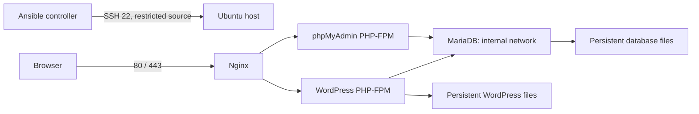

# Cloud-1 corrected readiness report

Updated: 2026-10-24.

**Status: the first Azure application deployment has completed, including Let's Encrypt issuance.** The user supplied the deployment log with `ok=54`, `changed=5`, `unreachable=0`, `failed=0` and confirmed that the websites open without a certificate warning. The local checks described below were performed before that deployment. The earlier “28/28” static result did not prove readiness and is superseded by the checks documented here.

The next milestone is the Azure acceptance run, followed by a repeat deployment, host reboot, second independent host and restore test. Those checks are not marked as passed without their results.

## Corrections

- Created the Certbot renewal-hook directory explicitly after the first remote deployment revealed it was absent. The next deployment obtained and installed the trusted certificate.
- Added a Vault editor helper for generating bootstrap passwords without printing them, and safe validation messages naming invalid variables only.
- Added progress output and bounded waits around slow Azure preflight commands.
- Replaced the lazy YAML generator check with real parsing; found and fixed an actual unquoted-colon YAML syntax error.
- Replaced bracket counting with Jinja parsing and rendered Docker Compose validation.
- Replaced substring health checks with exact parsed container health status. WordPress/phpMyAdmin check their FPM listener; Nginx checks its HTTP listener.
- Fixed TLS ordering: bootstrap certificate, start HTTP challenge server, then obtain the real certificate. Failures are no longer silently accepted as trusted TLS.
- Replaced certificate symlinks escaping the container mount with real copied files and a renewal deployment hook. Enabled the renewal timer.
- Replaced the shared secret environment file with individually mounted DB secret files. phpMyAdmin receives no database password or root secret; users authenticate interactively. WordPress receives only its application DB password.
- Corrected Alpine WordPress ownership to UID/GID 82. Repeated host setup preserves database ownership.
- Explicitly set the WP-CLI entrypoint and tested the actual Ansible initialization role. Passwords travel through stdin and tasks suppress logging. Repeat initialization is idempotent.
- Refuse implicit database credential rotation and silent domain migration on existing data. Existing WordPress account password changes remain an explicit operation.
- Removed play-level reloading of defaults that overrode per-host inventory settings. Example/test vaults are outside group_vars and cannot be auto-loaded.
- Empty default inventory prevents attempts to connect to placeholder public addresses. SSH host-key verification is enabled.
- Restricted SSH in UFW to the supplied administrator CIDR; NSG also restricts SSH. Only Nginx publishes web ports.
- Rewrote Azure script to use explicit subscription arguments, real JSON parsing, read-only preflight, actual quota listing, explicit creation confirmations and single-host inventory updates. Removed unverified fixed-price claims. The user subsequently ran preflight, reviewed the what-if preview, and confirmed the Azure deployment.
- Corrected backup password handling inside the database container, protected output permissions, and used the supported archive collection. Actual backup playbook executed successfully against disposable local data.
- Teardown preserves backups/configuration, requires explicit confirmation, guards its data path and no longer hides Compose teardown failures.
- Acceptance checks request response content explicitly and no longer claim that directory existence proves reboot persistence or that local checks prove external firewall enforcement.

## Checks executed

| Check | Result | What it establishes |
|---|---|---|
| `python cloud-1/scripts/local_validate.py` | PASS | 18 Ansible YAML files parsed, Jinja syntax, actual rendered Compose validation, network/secret/port assertions and shell syntax |
| `python cloud-1/scripts/test_regressions.py` | PASS: 4 tests | Invalid YAML rejection; inventory preserves other hosts and repeat writes; real acceptance expression rejects unhealthy/starting; least-privilege secret mounts |
| `ansible-playbook --syntax-check` on site, validate, backup, stop and destroy | PASS | Ansible recognizes all playbooks and required modules; nothing deployed |
| `ansible-lint --offline --profile basic cloud-1/ansible` | PASS | Lint checks; not proof of remote runtime behavior |
| Bicep `build` of `azure/main.bicep` | PASS | Template compiles locally to ARM JSON; no Azure calls |
| `bash cloud-1/scripts/test_tls_local.sh` | PASS | Self-signed SAN certificate/key generation |
| First Azure `site.yml` execution after corrections | PASS, supplied deployment log | Ubuntu configuration, application initialization and certificate issuance completed |
| Browser access | PASS, user confirmation | Sites open without a certificate warning |
| `python cloud-1/scripts/integration_local.py` | PASS | Actual official images start and become healthy; Nginx configuration passes |
| Same integration: real Ansible WordPress role | PASS | Installs WordPress and editor; second execution reports `changed=0`, no failures |
| Same integration: actual backup playbook | PASS | Database dump contains table definitions; WordPress archive task succeeds |
| Same integration: HTTP/HTTPS | PASS | HTTP redirect, WordPress response, phpMyAdmin response and blocked sensitive paths |
| Same integration: repeat/recreate | PASS | Repeat Compose preserves container IDs; recreation preserves a post and an upload; MariaDB has no published port |

The first integration attempt exposed a WP-CLI entrypoint error. It was corrected before the final successful run. The final test invokes the real initialization role rather than a hand-written equivalent. Test containers/networks/volumes are cleaned in a `finally` block. Official image cache remains local.

## Architecture and requirement coverage

| Subject requirement | Implementation | Remaining evidence |
|---|---|---|
| Fresh Ubuntu automation and roles | common, certificates, docker_stack, wordpress_init | First Azure deployment completed; log supplied |
| Compose and separate services | Four long-running services plus one-shot WP-CLI | Local integration passed |
| Working WordPress/database/phpMyAdmin | WordPress database integration and phpMyAdmin web endpoint | Interactive phpMyAdmin login/SQL operation on staging |
| Restart and persistent data | Docker enabled at boot; restart policies; persistent storage | Actual host reboot with post/account/upload checks |
| Parallel deployment | Independent host inventory and per-host domains; forks enabled | Two fresh hosts deployed together |
| Limited public access | NSG/UFW and only web ports published | External port scan from a separate machine |
| TLS and URL routing | Nginx routes `/` and `/phpmyadmin/`; bootstrap then Certbot | Issuance completed and browser trust confirmed; renewal dry run pending |
| Portable, idempotent automation | Parameterized paths and hosts; state-aware tasks | Full playbook second run on Ubuntu; WP initialization already tested twice |
| No hard-coded production secrets | Vault placeholders; narrowly mounted runtime secrets | Supply real encrypted vault before deployment |

## Remaining limitations and deployment gates

1. Subscription and quotas were checked before deployment: 6 regional vCPUs and 10 Basv2 family vCPUs were available. The original credit balance was $100; ongoing balance and expiry still need monitoring.
2. The first host has working DNS, an administrator CIDR, and SSH key access. Keep local inventory and credentials outside Git.
3. The full `site.yml` has completed on Ubuntu 22.04.5 LTS in Azure. Run `validate.yml` and retain its result; deployment completion alone does not establish all acceptance criteria.
4. Public HTTP-01 issuance completed and the user confirmed browser-trusted HTTPS. Run `certbot renew --dry-run` to test renewal separately.
5. Run full repeat-deployment, reboot and parallel-host tests. Zero changes on the WordPress role is narrower than full-playbook idempotency.
6. Verify phpMyAdmin login and an actual SQL query. A login-page HTTP 200 alone does not establish that workflow.
7. Restore a backup into a separate disposable environment and verify content. Backups are initially on-host, and database/files are not an atomic coordinated snapshot; stop writes when consistency across both is required.
8. Image family tags are mutable. Record/pin reviewed digests before evaluation. For phpMyAdmin upgrades, refresh only its static-files volume deliberately; do not delete application/database volumes.
9. Confirm the subject's “root account” sentence with the campus. Neither sudo nor direct-root SSH has been declared the definitive interpretation.

## Acceptance procedure

1. Deploy to a fresh approved Ubuntu host with encrypted credentials and correct DNS.
2. Run `validate.yml`, then test browser login to WordPress/phpMyAdmin and execute a database query.
3. Create a post, upload an image and add an account; back up.
4. Run deployment again; inspect changes and confirm content survives.
5. Reboot the host; verify automatic service recovery and all saved content.
6. Deploy to a second independent host in the same Ansible run; verify distinct sites and addresses.
7. Probe permitted and forbidden ports externally. Host-local listener checks cannot prove Azure ingress filtering.
8. Test trusted TLS, renewal dry-run and Nginx reload.
9. Restore backups in isolation and compare content.
10. Deallocate unneeded VMs; understand disk/IP charges continue. Delete resources only after explicitly confirming backup retention and desired data loss.

## Sources and AI disclosure

Official references consulted for image behavior:
- [WordPress official image documentation](https://github.com/docker-library/docs/blob/master/wordpress/README.md): Alpine CLI/service UID considerations.
- [phpMyAdmin official image](https://hub.docker.com/_/phpmyadmin): supported FPM variants.
- [phpMyAdmin image source](https://github.com/phpmyadmin/docker): image configuration.

Gemini authored the initial draft. Codex reviewed and corrected the implementation and ran the checks listed here. The student must review and understand the resulting code. The report deliberately separates local evidence from unperformed cloud tests.
